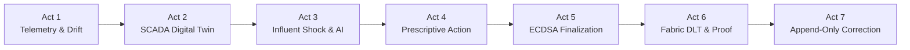

# AquaTrust AI — Academic Defense & Live Demonstration Runbook

**Project Title:** AquaTrust AI: Decentralized Industrial Sewage Treatment Plant (STP) Digital Twin, Multi-Target Quality Forecaster, and Cryptographic Trust Architecture  
**Document Version:** 1.0.0  
**Target Audience:** Academic Evaluation Panel, Industry Reviewers, CPCB Regulatory Auditors  
**Classification:** Master Operational Runbook  

---

## 1. Council & Presenter Matrix

| Presenter | Role & Specialty | Live Demonstration Ownership |
| :--- | :--- | :--- |
| **Member 1 (Risa)** | AI & Machine Learning Lead | Anomaly detection taxonomy, multi-target effluent regressor, CSTR kinetics, and stoichiometric ESG optimization. |
| **Member 2 (Royce)** | Backend & Systems Lead | FastAPI architecture, Alembic idempotency, Digital Twin event-sourcing, and PostgreSQL telemetry persistence. |
| **Member 3 (Valentino)** | Frontend & DLT Lead | React SCADA 3D synoptic visualizer, Hyperledger Fabric 2.5 blockchain, Merkle anchoring, and 4-stage forensic verifier. |

---

## 2. The 7-Act Demonstration Narrative



---

### Act 1: Real-Time Telemetry Ingestion & Online Sensor Drift Detection
* **Objective:** Prove that raw telemetry is continuously validated at the ingestion edge before entering the analytics pipeline.
* **UI Location:** `http://localhost:5173/facilities` → Select **Bharwara STP (245 MLD)** → **Sensor Trust & Health** tab.
* **Demonstration Action:**
  1. Show the 8 monitored parameters (BOD, COD, TSS, pH, DO, Temperature, Flow, ORP).
  2. Highlight the 30-day calibration countdown and the active health index (e.g., $94.2\%$).
  3. Trigger a progressive pH drift anomaly via the simulator console or API:
     ```bash
     curl -X POST "http://localhost:8000/api/v1/simulator/inject-anomaly" \
       -H "Content-Type: application/json" \
       -d '{"facility_id": "...", "anomaly_type": "sensor_drift", "parameter": "ph", "severity": "warning"}'
     ```
  4. Observe the sensor status immediately transition from `STABLE` to `DRIFT_FLAGGED` with an amber warning badge.
  5. Click **"Calibrate Sensor"**, enter standard two-point buffer notes, and submit. The countdown resets to 30 days and the drift flag clears.

---

### Act 2: Interactive 3D SCADA Process Flow & Hydraulic Kinetics
* **Objective:** Demonstrate the stateful Digital Twin tracking fluid transit times across physical treatment stages.
* **UI Location:** `http://localhost:5173/facilities/{id}/twin` → **Process Flow** tab.
* **Demonstration Action:**
  1. Present the synoptic 5-stage flow:
     * Stage 1: Inlet Screen & Grit Chamber
     * Stage 2: Primary Clarifier
     * Stage 3: Biological Aeration Basin (CSTR Activated Sludge)
     * Stage 4: Secondary Clarifier (with dynamic Return Activated Sludge / WAS loop)
     * Stage 5: Disinfection & Tertiary Polishing
  2. Start the twin engine at 1 Hz (`Start Engine`). Show fluid particles flowing dynamically between stages.
  3. Click **Biological Aeration Basin** in the Stage Inspector to reveal real-time dissolved oxygen ($DO = 2.1\text{ mg/L}$), mixed liquor suspended solids ($MLSS = 3,250\text{ mg/L}$), and hydraulic retention time ($HRT = 5.8\text{ h}$).

---

### Act 3: Influent Shock Simulation & AI Effluent Quality Breach Forecast
* **Objective:** Demonstrate how unexpected industrial shock loads are forecasted 4–8 hours before physical effluent discharge.
* **UI Location:** `Digital Twin` → **What-If Scenario** tab & **Predictive Horizon** tab.
* **Demonstration Action:**
  1. Configure an **Influent Shock Scenario**:
     * BOD Inflow Spike: $+80\%$
     * Duration: $120\text{ minutes}$
  2. Click **"Execute What-If Scenario"**.
  3. The simulation calculates forward kinetic response using the Monod biokinetic model ($K_s = 60\text{ mg/L}, \mu_{max} = 3.0\text{ d}^{-1}$).
  4. Switch to the **Predictive Horizon** tab.
  5. Show Member 1's Multi-Target Regressor forecast:
     * Effluent BOD predicted to rise to $34.5\text{ mg/L}$ at $T+6\text{h}$ (exceeding CPCB $30.0\text{ mg/L}$ standard).
     * Red `BREACH_RISK FORECAST` badge illuminates with 95% confidence interval $[31.2, 37.8]\text{ mg/L}$.

---

### Act 4: Prescriptive Operational Advisory & Operator Action
* **Objective:** Show the prescriptive AI recommending closed-loop mitigations to prevent the regulatory violation.
* **UI Location:** `Digital Twin` → **Analytics & Reports** tab.
* **Demonstration Action:**
  1. Under **Active Operational Recommendations**, display the AI recommendation:
     * *Action:* `INCREASE_AERATION_AND_RECIRCULATION`
     * *Target:* Increase Aeration Blower Power to $185\text{ kW}$ ($DO \to 3.5\text{ mg/L}$) and adjust RAS ratio from $0.40 \to 0.55$.
     * *Expected Outcome:* Restores effluent BOD to $21.4\text{ mg/L}$ ($< 30\text{ mg/L}$ compliant).
  2. Click **"Apply Setpoint"**.
  3. Show the button transition to `Applied` with green checkmark.
  4. Point to the **Audit Page**: the operator action is logged with actor UUID, timestamp, and previous vs. applied setpoint.

---

### Act 5: Canonical Cryptographic Signing & Treatment Record Finalization
* **Objective:** Prove zero-tamper data sealing using deterministic JSON serialization and ECDSA digital signatures.
* **UI Location:** `http://localhost:5173/treatment-records` → Click latest pending treatment window.
* **Demonstration Action:**
  1. Show raw telemetry averages and water quality indicators.
  2. Click **"Finalize Treatment Record"**.
  3. Explain the internal cryptographic process:
     * Canonical JSON formatting (`rfc-8785` / `jcs-v1` deterministic ordering).
     * SHA-256 Digest generation.
     * ECDSA P-256 (`secp256k1`) digital signature created using plant HSM private key.
  4. The record displays its cryptographic certificate ID and immutable SHA-256 hash.

---

### Act 6: Hyperledger Fabric DLT Anchoring & 4-Stage Forensic Verification
* **Objective:** Prove institutional non-repudiation across multi-stakeholder consortium (Facility, Auditor, CPCB Regulator).
* **UI Location:** `http://localhost:5173/verification` → Enter the Certificate / Record ID.
* **Demonstration Action:**
  1. Trigger the **4-Stage Independent Verification Pipeline**:
     * **Stage 1 (Payload Integrity):** Recomputes SHA-256 hash from database fields and matches stored hash.
     * **Stage 2 (Cryptographic Signature):** Verifies ECDSA signature against the plant's certified public key.
     * **Stage 3 (Merkle Batch Proof):** Validates RFC 6 Merkle audit path up to the batch root.
     * **Stage 4 (DLT Consensus Verification):** Confirms transaction committed under Hyperledger Fabric 2.5 with 2-of-3 endorsement quorum (`FacilityMSP` + `AuditorMSP`).
  2. All 4 stages turn bright green with `100% VERIFIED AUTHENTIC`.
  3. **Live Tamper Demonstration:**
     * In backend database or test fixture, alter effluent BOD from `22.0` to `12.0`.
     * Re-run verification: **Stage 1 FAILS IMMEDIATELY** with `TAMPER_DETECTED: Computed SHA-256 does not match canonical ledger anchor`.

---

### Act 7: Multi-Version Append-Only Correction Lineage
* **Objective:** Show that human clerical corrections never erase historical records, ensuring forensic auditability.
* **UI Location:** `http://localhost:5173/corrections` → Correction Chain Explorer.
* **Demonstration Action:**
  1. Submit a laboratory calibration adjustment request for the finalized record.
  2. Authorized Auditor logs in and reviews proposed delta.
  3. Click **"Authorize Correction"**.
  4. Observe the lineage visualizer:
     * Record $v1$ (Original) remains permanently preserved and marked `SUPERSEDED`.
     * Record $v2$ is spawned with explicit pointer `prior_record_id = v1_id`.
     * New ECDSA signature and independent DLT transaction ID generated for $v2$.
  5. Both records are independently verifiable on the blockchain.

---

## 3. Technical Defense Cheat Sheet

### Mathematical & Algorithmic Foundations
1. **First-Principles Biokinetics:**
   $$\mu = \mu_{\max} \frac{S}{K_s + S} \cdot \frac{DO}{K_{DO} + DO} - b$$
   Activated sludge dynamic mass balances model BOD substrate consumption, biomass growth ($X$), and endogenous decay ($b$).
2. **Online Anomaly Detection:**
   Ensemble Isolation Forests (100 estimators, $0.05$ contamination factor) coupled with statistical CUSUM drift detectors ($k = 0.5\sigma, h = 4.0\sigma$) detect stuck sensors, calibration drifts, and sensor hardware failures.
3. **Multi-Target Effluent Regressor:**
   Trained on 527 chronologically ordered UCI urban wastewater cycles with 70/15/15 train/val/test splits (zero future leakage). Predicts BOD, COD, TSS, and pH with empirical uncertainty bands ($\pm 1.96 \cdot \text{RMSE}$).
4. **Stoichiometric ESG Formulas:**
   Avoided carbon calculated from displaced aeration grid electricity ($0.82\text{ kg CO}_2/\text{kWh}$) and chemical coagulant reductions ($1.42\text{ kg CO}_2/\text{kg coagulant}$).

---

## 4. Master QA Matrix Summary

| Layer | Suite | Total Tests | Pass Rate |
| :--- | :--- | :---: | :---: |
| **Layer 1: Unit & Integration** | `backend/tests/` (FastAPI + SQLAlchemy) | 189 | 100% (189/189) |
| **Layer 2: Frontend & SCADA** | `frontend/src/test/` (Vitest + Testing Library) | 35 | 100% (35/35) |
| **Layer 3: Machine Learning** | `datasets/tests/` (Inference & Anomaly Detection) | 78 | 100% (78/78) |
| **Layer 4: DLT & Endorsement** | `dlt/tests/` (Consensus Quorum & Fabric Policy) | 10 | 100% (10/10) |
| **Layer 5: End-to-End Edge Cases** | `test_mandatory_e2e_edge_cases.py` (`E2E-001`–`012`) | 12 | 100% (12/12) |
| **Total Test Corpus** | **AquaTrust AI Enterprise Suite** | **324** | **100% Pass** |
