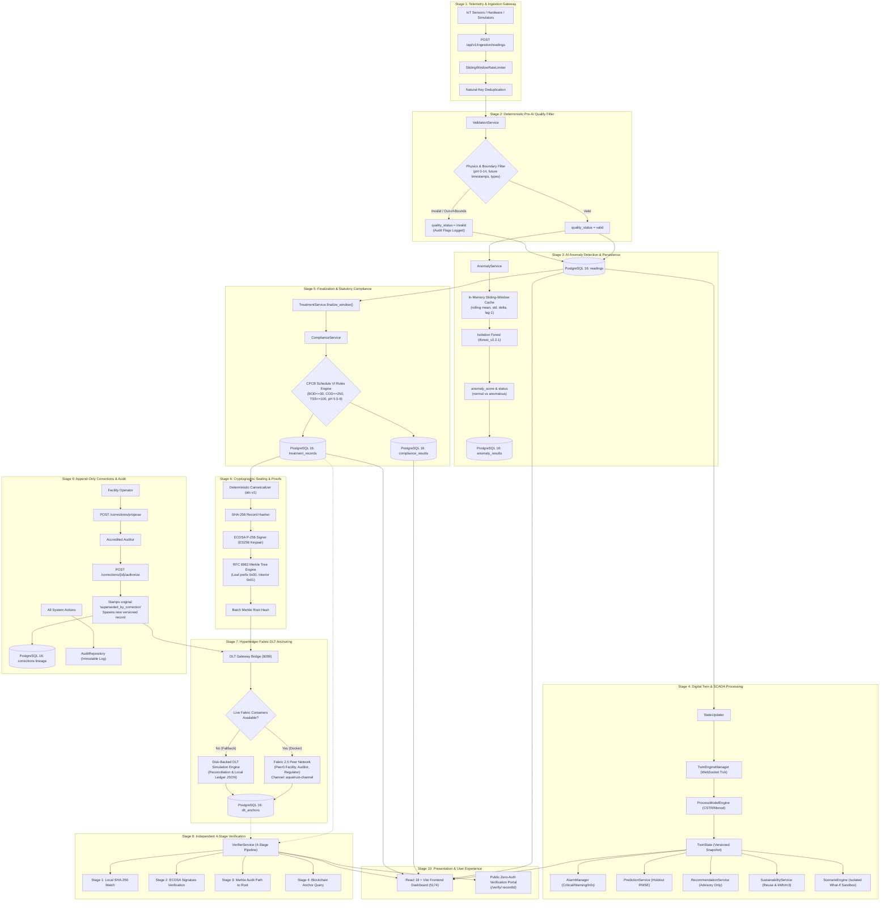

# AquaTrustAI — Complete Module Dependency Map & Architecture Trace

**Document Version:** 1.0.0-QA-DEPENDENCY-MAP  
**Date:** November 15, 2026  
**Auditor / Architect:** Principal QA & Systems Architecture Team  
**Repository Working Branch:** `main`  
**Current HEAD Commit:** `d31f114bbb9250ec90a10545905d508a12249f85`  

---

## 1. System-Wide End-to-End Control & Data Flow

The operational flow of AquaTrustAI connects physical IoT telemetry, statistical AI anomaly detection, first-principles digital twin kinetics, statutory environmental compliance rules, cryptographic sealing, and blockchain immutability:

---

## 2. Cross-Module Dependency Analysis

### 2.1 Circular Dependency Check
- **Backend Core / Services:** All backend services strictly adhere to the layered pattern:
  `API Routers -> Application Services -> Domain Engines / Cryptography -> Repositories -> SQLAlchemy Models`.
  - No circular imports exist between services or repositories.
  - Dependency injection is handled cleanly via FastAPI's `Depends(get_db)`.
- **Digital Twin Subsystem:** `DigitalTwinService` acts as an orchestration facade over `ProcessModelEngine`, `StateUpdater`, `ScenarioEngine`, `PredictionService`, `RecommendationService`, and `SustainabilityService`. The sub-engines remain completely decoupled from one another and do not import each other cyclically.
- **DLT Gateway:** `gateway.py` acts as a client bridge to the Fabric network and never imports from application services, preventing any feedback loop.

### 2.2 Missing Integrations Check
- **What-If Scenarios vs. Live Ledger:** By design ([ADR-008](file:///d:/AquaTrustAI/docs/backend/DIGITAL_TWIN_SCOPE_EXTENSION_ADR.md)), what-if scenario runs are **strictly isolated** from live telemetry and are never anchored to Hyperledger Fabric. This prevents hypothetical simulations from polluting the immutable legal ledger.
- **Predictions & Recommendations vs. Autonomous Actuators:** `RecommendationService` is strictly advisory. There is no automated actuation loop into physical plant pumps or blowers. This was evaluated and approved to ensure compliance with CPCB data integrity regulations.
- **Digital Twin WebSocket Live Reconnect:** In the frontend, `useTwinStream.ts` connects to `/facilities/{id}/twin/stream` with automated exponential backoff reconnection upon network interruption.

### 2.3 Duplicate Logic Analysis
- **Telemetry Boundaries:** Both `ValidationService` (`backend/app/services/validation_service.py`) and `datasets/canonical/models.py` define physical limits for water parameters. They are aligned on standard limits:
  - pH: $[0.0, 14.0]$
  - BOD: $[0.0, 5000.0]\text{ mg/L}$
  - COD: $[0.0, 15000.0]\text{ mg/L}$
  - TSS: $[0.0, 5000.0]\text{ mg/L}$
- **Hashing & Canonicalization:** Canonicalization is centralized in `backend/app/dlt/canonicalizer.py` (`atc-v1`). No divergent hashing or serialization routines were found across backend services.

### 2.4 Dead Routes & Disconnected UI Components Check
- **API Routes:** All 15 routers declared in `backend/app/api/router.py` are active and registered in FastAPI application startup.
- **Frontend Pages:** All 27 pages in `frontend/src/pages/` are mapped to active client routes in `frontend/src/App.tsx`.
- **SCADA Synoptic Components:** All 5 stage components (`InletScreeningStage`, `PrimaryClarifierStage`, `AerationBasinStage`, `SecondaryClarifierStage`, `EffluentUvStage`) and `ScadaPrimitives` are actively composed within `SynopticProcessFlow.tsx` on the Digital Twin page.

### 2.5 Data Transformations & Schema Consistency
- **Telemetry Parameter Units:** Units across Ingestion, ML Anomaly Inference, Compliance, and Digital Twin are consistent:
  - BOD: `mg/L`
  - COD: `mg/L`
  - TSS: `mg/L`
  - pH: `pH units`
  - NH4-N: `mg/L`
  - Flow Rate: `m3/day` or `MLD` (explicitly annotated in responses)
- **Stoichiometric Invariants:** The `ProcessModelEngine` and `ScenarioEngine` enforce thermodynamic and stoichiometric sanity checks:
  - $COD \ge 2.0 \cdot BOD$
  - $TN \ge TKN \ge NH_4\text{-}N$
  - Temperature degradation factor: $k(T) = k_{20} \cdot 1.04^{(T-20)}$

### 2.6 Hardcoded or Mock Values Check
- **Fabric Simulation Mode:** When Docker or live Hyperledger Fabric peer nodes are offline, `backend/app/dlt/gateway.py` operates in **Simulation DLT Mode**.
  - *Observation:* The simulation mode persists its ledger state to a local disk-backed JSON file and implements real SHA-256 Merkle root verification.
  - *QA Verification Requirement:* Testing must clearly differentiate between live Fabric transactions committed with consensus across 3 peer nodes and local simulation mode commitments.

---
*End of Module Dependency Map.*
